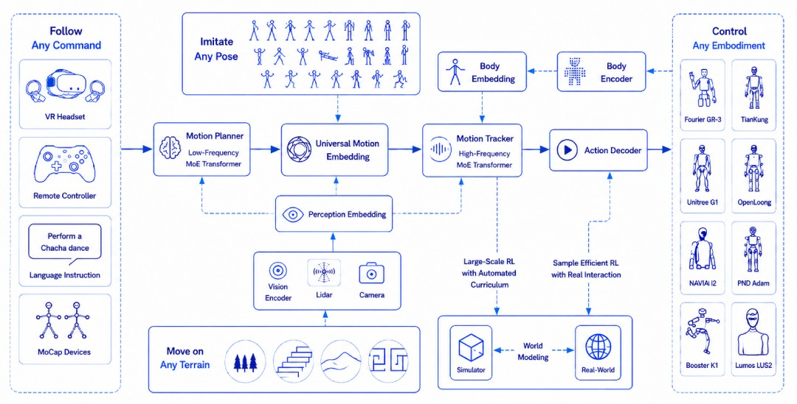
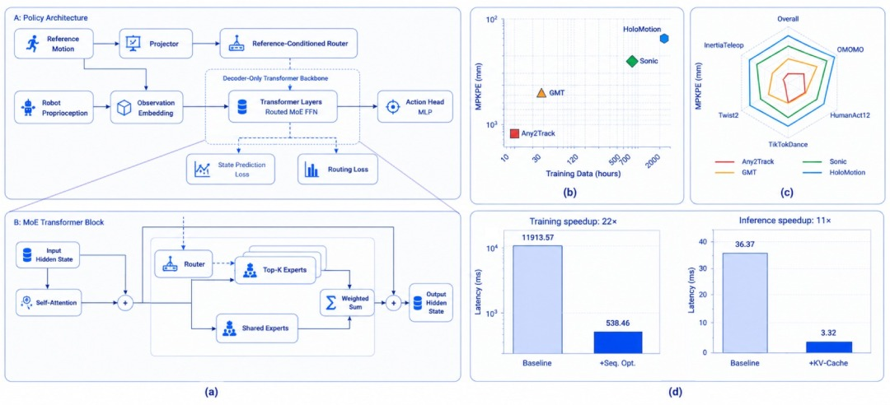
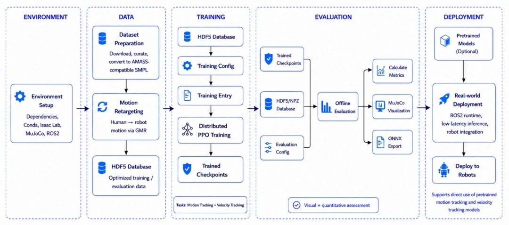
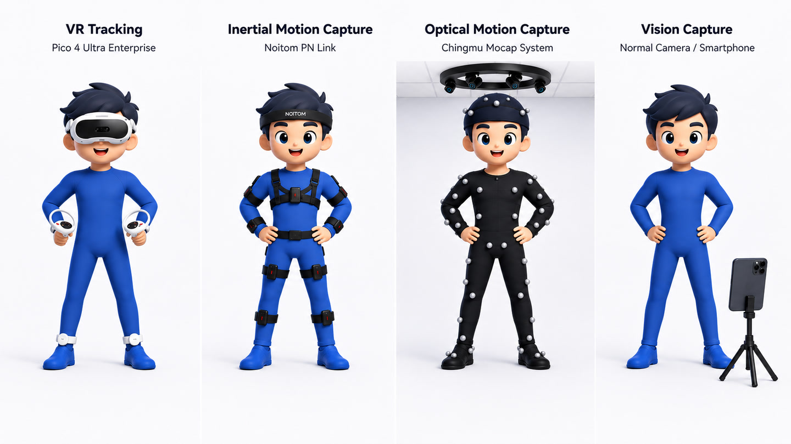

<div align="center">


[](https://horizonrobotics.github.io/robot_lab/holomotion/)
[](https://huggingface.co/collections/HorizonRobotics/holomotion)
[](https://hub.docker.com/r/horizonrobotics/holomotion/tags)
[](https://horizonrobotics.feishu.cn/docx/Xs3cdEI8bo1EZuxUfzjckTgKn2c)
[](https://arxiv.org/abs/2605.15336)
[](https://space.bilibili.com/650643249)


</div>

# Latest News

- [2026.10.24] 🚀 **We now support [SuperMimic](docs/supermimic.md) in HoloMotion!** Train G1 motion trackers from scratch on **a single GPU**, with **MuJoCo Warp or Isaac PhysX**. We achieved **80% SR on LAFAN1 in 30 minutes on a single RTX 5090**.

  <p align="center">
    <a href="docs/supermimic.md"></a>
  </p>

- [2026.10.22] The [H-bot Competition](https://hbot-competition.horizon.auto/) is now open! Follow our [Track 2 boxing tutorial](holoboxing/README.md) to train a baseline policy in about **21 minutes on a single GPU**.
- [2026.10.12] HoloMotion v2.0 brings one policy for sparse-to-whole-body control, with initial 1-point and 5-point real-robot teleoperation demonstrated.


# Why HoloMotion?

## Scales Toward 4-Any Humanoid Control

HoloMotion progresses from general motion tracking in v1 to flexible command following in v2, then toward cross-embodiment generalization in v3 and terrain generalization in v4.

<p align="center">
  
</p>

| Version | Target Capability | Status | Focus |
| --- | --- | --- | --- |
| **v1** | Any Pose | ✅ Released | Scale motion tracking with large pretrained models, fast inference, and generalization to unseen motions and real robots. |
| **v2** | Any Command | 🚀 Preview | Unify sparse-to-whole-body commands in one policy, with an SMPL interface for cross-modal extensions. |
| **v3** | Any Embodiment | 🧭 Planned | Generalize motion and command following across humanoids with different morphologies and actuation. |
| **v4** | Any Terrain | 🧭 Planned | Adapt whole-body control to uneven and dynamic terrain, maintaining balance and coordinated motion in complex environments. |

### HoloMotion v1: Larger, Faster and Stronger as a Motion Tracker

HoloMotion v1 uses a reference-conditioned MoE Transformer to track diverse human motions on humanoid robots.

- **Larger:** Up to 0.4B parameters trained on 2,000+ hours of motion, combining video-derived data with motion capture.
- **Faster:** Sequence-level training and KV-cache inference support efficient learning and real-time control.
- **Stronger:** Generalization to unseen motion datasets and real-robot transfer without task-specific fine-tuning, as documented in the [HoloMotion-1 Technical Report](https://arxiv.org/abs/2605.15336).

<p align="center">
  
</p>

### HoloMotion v2: Flexible Sparse-to-Whole-Body Command Following with Cross-Modal Extensibility

- **One policy, multiple command modes:** Pelvis-1 and Keypoint-5 (pelvis, wrists, and ankles) use the same model with selectable control-point masks.
- **Cross-modal extensibility through SMPL:** The shared SMPL interface is designed to simplify integration of external text-to-motion and music-to-motion models; these adapters are not yet included.
- **Live teleoperation:** Initial 1-point and 5-point PICO VR trials have been completed on G1. See [deployment](docs/realworld_deployment.md).

v2.0 is in release preparation; real-robot gait and tracking quality are still being refined, especially for pelvis-only control. Validation coverage varies across modes.

## One End-to-End Framework: From Motion Data to Robot Control

<p align="center">
  
</p>

[Motion Conversion](holosmpl/README.md) → [Retargeting](docs/motion_retargeting.md) → [Policy Training](docs/train_motion_tracking.md) → [Simulation Evaluation](docs/evaluate_motion_tracking.md) → [Robot Deployment](docs/realworld_deployment.md)

### Unifies Diverse Motion Sources

[HoloSMPL](holosmpl/README.md) standardizes VR, inertial, optical, and vision capture into a shared representation. [HoloRetarget](docs/motion_retargeting.md) converts these motions into robot references for data generation and live teleoperation.

<p align="center">
  
</p>

### No Per-User Training Required

Start with the [v2.0.0 motion-tracking checkpoint](https://huggingface.co/HorizonRobotics/HoloMotion_models/tree/main/HoloMotion_motion_tracking_model_v2.0.0) for simulation and live control; train or fine-tune only when you need to adapt the policy.

| Goal | Guide | Starting Point |
| --- | --- | --- |
| Replay a motion in MuJoCo | [Sim2sim](docs/evaluate_motion_tracking.md#2-sim2sim-inspect-a-reference-motion) | ONNX/config bundle and a robot NPZ clip. |
| Evaluate a motion dataset | [Quantitative evaluation](docs/evaluate_motion_tracking.md#3-quantitative-evaluation-on-your-hdf5-dataset) | ONNX/config bundle, actor weights, and robot HDF5 data. |
| Validate and test a boxing policy | [HoloBoxing local evaluation](holoboxing/README.md) | Your high-level boxing policy (ONNX), the bundled evaluation image, and a compatible GPU. |
| Teleoperate a G1 | [Robot deployment](docs/realworld_deployment.md) | G1 29-DOF with Orin, matching deployment image, and PICO / XRoboToolkit. |
| Train or fine-tune | [Training](docs/train_motion_tracking.md) | Labeled robot HDF5 data and GPU resources; a compatible checkpoint for fine-tuning. |
| Train a lightweight motion tracker from scratch | [SuperMimic](docs/supermimic.md) | G1 reference motions, one CUDA GPU, and the selected simulator environment. |

For workstation workflows, begin with [environment setup](docs/environment_setup.md). Each guide specifies the required artifacts and commands.

# Projects Using HoloMotion

| Organization | Project | Use of HoloMotion | Links |
| --- | --- | --- | --- |
| **Tsinghua University · MARS Lab** | **OMG** | Uses HoloMotion as the tracker for executing generated motions, with G1 deployment workflows. | [Paper](https://arxiv.org/abs/2606.10340) / [Project](https://tsinghua-mars-lab.github.io/OMG/) / [Code](https://github.com/Tsinghua-MARS-Lab/OMG) |
| **Peking University · School of Computer Science** | **HumanoidTTT** | Keeps HoloMotion frozen as the whole-body tracker for reusing validated motions. | [Paper](https://arxiv.org/abs/2610.00198) / [Project](https://aigeeksgroup.github.io/HumanoidTTT/) / [Code](https://github.com/AIGeeksGroup/HumanoidTTT) |
| **RoboParty Lab** | **sim2real** | Supports the official HoloMotion v1.4.0 ONNX policy in its simulation and robot deployment stack. | [Code](https://github.com/EGalahad/sim2real) / [Docs](https://egalahad.github.io/sim2real/) |
| **ccrpRepo** | **RoboMimic Deploy** | Implements HoloMotion as a selectable G1 policy, with ONNX inference and motion or velocity tracking modes. | [Code](https://github.com/ccrpRepo/RoboMimic_Deploy) / [HoloMotion policy](https://github.com/ccrpRepo/RoboMimic_Deploy/blob/master/policy/holomotion/HoloMotion.py) |
| **Renforce Dynamics** | **GenesisLab / genPiHub** | Integrates HoloMotion v1.2 into Genesis simulation. Velocity tracking is implemented; motion tracking is still in progress. | [GenesisLab](https://github.com/Renforce-Dynamics/genesislab) / [genPiHub](https://github.com/Renforce-Dynamics/genPiHub) |


# Citation

The **HoloMotion-2 Technical Report** is scheduled for release alongside **HoloMotion v2.1 at the end of October 2026**. In the meantime, please cite the HoloMotion-1 report:

```bibtex
@misc{chen2026holomotion1,
  title = {HoloMotion-1 Technical Report},
  author = {Maiyue Chen and Kaihui Wang and Bo Zhang and Xihan Ma and Zhiyuan Yang and Yi Ren and Qijun Huang and Zihao Zhu and Yucheng Wang and Zhizhong Su},
  year = {2026},
  eprint = {2605.15336},
  archivePrefix = {arXiv},
  primaryClass = {cs.RO},
  url = {https://arxiv.org/abs/2605.15336}
}
```

# Acknowledgements

Built on and inspired by these open-source projects:

- [ASAP](https://github.com/LeCAR-Lab/ASAP)
- [BeyondMimic](https://github.com/HybridRobotics/whole_body_tracking)
- [GMR](https://github.com/YanjieZe/GMR)
- [GVHMR](https://github.com/zju3dv/GVHMR)
- [Humanoidverse](https://github.com/LeCAR-Lab/HumanoidVerse)
- [Mink](https://github.com/kevinzakka/mink)
- [MotionMillion](https://github.com/VankouF/MotionMillion-Codes)
- [PBHC](https://github.com/TeleHuman/PBHC)
- [PHC](https://github.com/ZhengyiLuo/PHC)
- [ProtoMotion](https://github.com/NVlabs/ProtoMotions/tree/main/protomotions)
- [ScaleBFM](https://github.com/zengweishuai/ScaleBFM)
- [SONIC](https://github.com/NVlabs/GR00T-WholeBodyControl)
- [SuperMimic](https://arxiv.org/abs/2610.28480) [[1]](https://github.com/zita-ch/supermimic_vibed) [[2]](https://github.com/CuboiLeo/SuperMimic-Reproduced).
