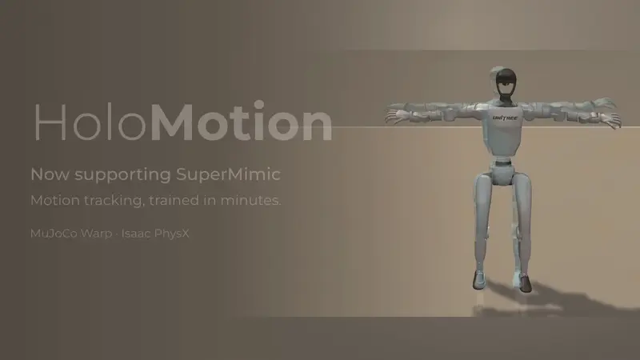
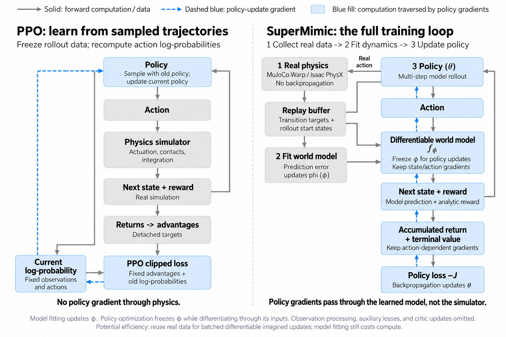
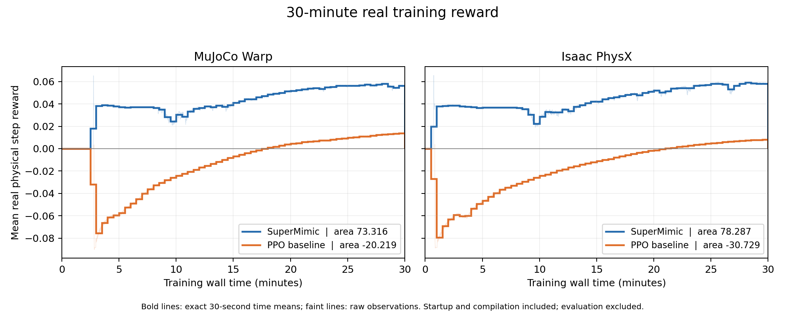

# 在 HoloMotion 中训练 SuperMimic 动作跟踪策略

[English](supermimic.md) | 简体中文

**用一张 CUDA 显卡，从零训练轻量 G1 动作跟踪策略。**
本教程复用 HoloMotion 的 HDF5 动作数据、G1 机器人资源和训练入口，支持 MuJoCo Warp 与 Isaac PhysX。
所选 MuJoCo 方案在**单张 RTX 5090 上训练 30 分钟后，40 个完整 LAFAN1 训练片段通过 32 个，成功率为 80%**。
具体配置和成绩见[30 分钟实测结果](#7-30-分钟实测结果)。

<div align="center">
  
</div>

动画上行为 MuJoCo Warp，下行为 Isaac PhysX；左列为 PPO，右列为 SuperMimic。
动画长 60 秒，按动作原速播放，展示一次独立训练中每隔 3 分钟保存的策略，覆盖第 0 至第 30 分钟。
各格均从同一动作的首帧开始，播放前 5 秒。机器人跌倒后仍继续执行策略和原生物理仿真。
动画用于展示训练过程，与下方完整片段成功率的实测记录分开。

## 为什么在 HoloMotion 中使用 SuperMimic？

如果已有 G1 参考动作，希望用一张显卡训练或适配轻量跟踪策略，可以使用本教程。
SuperMimic 学习一个可微的世界模型，让每次物理仿真采集的数据参与更多策略更新。

### 复用物理采样，提高数据利用率



PPO 在多个更新轮次中复用采集的轨迹，通过动作对数概率和已截断梯度的优势估计更新策略。
SuperMimic 还会用回放中的真实转移拟合世界模型，再用该模型生成当前策略下的多步轨迹，用于策略更新。

拟合世界模型时，更新其参数 φ。
更新策略时，冻结 φ，但保留经过模型状态输入、动作输入、解析奖励和轨迹末端价值的梯度。
物理仿真器不参与反向传播。

把部分策略训练轨迹从接触求解转为批量神经网络计算，可以减少获取学习信号所需的计算。
拟合模型和对模型轨迹反向传播也有开销。实际收益取决于模型大小、预测步数、批量大小、预测质量和硬件。
下方的[30 分钟实测结果](#7-30-分钟实测结果)记录了对应配置下，真实训练奖励随实际训练时间的变化。

### 复用 HoloMotion 流程，选择不同仿真后端

- **沿用已有数据与机器人资源。** 使用 HoloMotion 的 HDF5 读取器、原 G1 资源、Hydra 配置和训练入口。
- **比较算法与仿真后端。** SuperMimic 和轻量策略 PPO 共用动作数据、观测、控制目标、奖励及完整片段评测规则，可分别在 MuJoCo Warp 和 Isaac PhysX 上运行。
- **核查每次实验。** 保存实际配置、源码与输入指纹、检查点、训练奖励曲线和原始评测转移，便于追溯结果。

本集成将上游轻量方案接入 HoloMotion 的 HDF5 数据、G1 资源、Hydra 命令和两个仿真后端。
同时提供共享任务与评测接口、训练曲线、学习状态恢复，以及源码和输入校验。
上游实现与许可说明见[参考资料与实现说明](#参考资料与实现说明)。

### 当前范围与后续计划

已验证的策略网络约有 900 万参数。这个规模便于在单张显卡上检查完整训练流程。
后续计划支持大模型 SuperMimic，并接入 HoloMotion 的 Transformer、MoE 和时序状态接口。
大模型上的效率收益尚未验证，需要单独测量。
如果需要使用已有的稀疏输入到全身控制预训练策略，请参阅 [HoloMotion v2 指南](../README.md#holomotion-v2-flexible-sparse-to-whole-body-command-following-with-cross-modal-extensibility)。

## 1. 安装独立环境

准备 Python 3.11、NVIDIA CUDA 显卡和兼容的显卡驱动。
已有实测使用 RTX 4090 和 RTX 5090。最低显存要求尚未确定。

从仓库根目录运行以下命令：

```bash
python3.11 -m venv .venv-supermimic
source .venv-supermimic/bin/activate
python -m pip install --upgrade pip
python -m pip install torch==2.9.1 --index-url https://download.pytorch.org/whl/cu128
python -m pip install -r environments/requirements_supermimic.txt
python -m pip install --no-deps -e .
python -m pip check
```

这套 MuJoCo Warp 方案无需启动 Isaac Sim 或 Isaac Lab。后续命令请继续使用刚创建的独立环境。

使用 Isaac PhysX 时，请切换到仓库配套的 Isaac Sim 5.0、Isaac Lab 2.2 环境。
不要在该环境中安装 MuJoCo Warp 的依赖清单，以免覆盖仿真器依赖。
通过 `algo.config.physics_backend=isaac_physx` 选择后端。
启动器会分别在受管理的独立进程中运行训练和最终评测。
Isaac 当前支持全新训练和最终评测，尚不支持训练期间的周期评测和检查点恢复。

检查当前运行环境：

```bash
python -c 'import torch, mujoco, warp; print(torch.__version__, mujoco.__version__, warp.__version__); print(torch.cuda.is_available())'
```

MuJoCo 环境的物理依赖版本应为 MuJoCo 3.16.0 和 Warp 1.18.0。
默认网络计算使用 BF16；物理状态、奖励和归一化使用 FP32 张量。

## 2. 准备参考动作

参考数据包含 40 个完整的 G1 LAFAN1 CSV 动作片段，采样频率为 30 Hz。
每行依次保存根部 XYZ 位置、XYZW 顺序的四元数，以及按 SDK 顺序排列的 29 个关节角。
请从 [lvhaidong/LAFAN1_Retargeting_Dataset](https://huggingface.co/datasets/lvhaidong/LAFAN1_Retargeting_Dataset) 下载 `g1/` 下的 CSV 文件。
实测固定使用数据版本 `ce1572906efe6157840e8474d5a0d7aa87481e74`。
动作数据沿用来源方的使用条款，本实现不重新分发这些数据。

可使用 [Hugging Face CLI](https://huggingface.co/docs/huggingface_hub/guides/cli) 下载：

```bash
python -m pip install huggingface-hub
hf download lvhaidong/LAFAN1_Retargeting_Dataset \
  --repo-type dataset \
  --revision ce1572906efe6157840e8474d5a0d7aa87481e74 \
  --include 'g1/*.csv' --local-dir data/lafan1-source
```

将完整片段转换为 HoloMotion HDF5 数据：

```bash
python -m holomotion.scripts.training.prepare_supermimic_lafan1 \
  --source data/lafan1-source/g1 --output data/lafan1-g1-hdf5
```

转换程序会将姿态重采样至 50 Hz，并写入 `manifest.json`、`motions.h5` 和源文件指纹。
程序保留完整片段，不划分独立测试集。
随后由 HoloMotion 标准读取器按原有规则处理初始 XY 位置和偏航角归一化。

机器人资源路径为 `assets/robots/unitree/G1/29dof/g1_29dof_rev_1_0.urdf`。
请保留 URDF 引用的网格文件及其相对路径。
训练方案会在实验目录生成自己的 MuJoCo 模型，不修改原机器人资源。

## 3. 训练前检查物理执行

```bash
CUDA_VISIBLE_DEVICES=0 python -m holomotion.src.training.train \
  --config-name=training/motion_tracking/supermimic \
  motion_h5_path=data/lafan1-g1-hdf5/manifest.json \
  robot_urdf=assets/robots/unitree/G1/29dof/g1_29dof_rev_1_0.urdf \
  experiment_name=supermimic-preflight \
  num_envs=2 algo.config.preflight_only=true \
  algo.config.warmup_steps=4 algo.config.capture_graph=false
```

`training/run_status.json` 显示执行完成，只能说明物理流程已运行，不能证明策略已经学会跟踪。
如果出现容量溢出或非有限数值，程序会判定运行无效，并保留诊断记录。

## 4. 单卡训练

使用所选的 30 分钟 MuJoCo 配置，从零开始训练：

```bash
PYTORCH_CUDA_ALLOC_CONF=backend:cudaMallocAsync CUDA_VISIBLE_DEVICES=0 \
python -m holomotion.src.training.train \
  --config-name=training/motion_tracking/supermimic_30min \
  motion_h5_path=data/lafan1-g1-hdf5/manifest.json \
  robot_urdf=assets/robots/unitree/G1/29dof/g1_29dof_rev_1_0.urdf \
  experiment_name=supermimic-30min
```

该配置使用 24 步预测时域、`4e-4` 学习率，单个策略微批次处理完整的 4,096 个样本。
训练预算为 1,800 秒。训练结束后评测最终策略，预算内不执行周期评测。
对应的 Isaac 配置使用 `algo.config.physics_backend=isaac_physx`，并在 Isaac 环境中省略 MuJoCo 的显存分配器前缀。
两者的完整训练与评测指标见下方结果表。
原 `training/motion_tracking/supermimic` 配置仍保留，可用于参考方案或较小的微批次。

默认 `paper` 配置包含 93 维本体观测、10 帧历史和 10 帧未来参考动作。
`vibed` 配置额外增加 6 维相对朝向观测，并关闭 MuJoCo 自碰撞。
Isaac 在两种观测配置下均保留自碰撞。
比较结果时，请保留配置名称。`paper` 名称不表示已精确复现论文中所有未明确给出的细节。

训练交替执行真实采样、世界模型拟合、模型轨迹上的策略更新，以及价值网络拟合。
实际配置会记录批量大小、预热步数、更新比例和实测耗时。
一次更新可能在预算截止后才完成，请以记录中的实际训练预算为准。

策略更新显存不足时，优先减小 `algo.config.pi_microbatch`。
微批次把一次策略更新拆开处理，不改变该次更新计划使用的样本总量。
修改 `num_envs`、逻辑批量大小或更新比例会改变样本复用方式，需作为不同配置单独记录。
所选方案使用 `algo.config.pi_microbatch=4096`，一次处理完整策略批量。

默认 `algo.config.release_phase_cache=true` 会在物理计算启动前检查可用显存，仅在显存紧张时释放未使用的 Torch 缓存。
该机制根据设备实际容量，为独立的物理仿真分配预留保守空间，不释放仍在使用的张量。
预留量是安全余量，不是已测得的瞬时显存需求。
只有确认当前任务显存充足后，才建议关闭。

使用 MuJoCo 时，在命令前添加 `PYTORCH_CUDA_ALLOC_CONF=backend:cudaMallocAsync`，选择 Torch 异步显存分配器。
可在 `specification.json` 中核对实际分配器，在 `report.json` 中查看缓存释放记录。
`TORCHINDUCTOR_CACHE_DIR` 和 `WARP_CACHE_PATH` 用于指定可写的编译缓存目录。编译耗时计入训练预算。

## 5. 查看输出与恢复训练

实验默认保存在 `logs/motion_tracking/<timestamp>-<experiment_name>/`。
根目录保存解析后的框架配置，`training/` 保存训练产物。

| 文件或目录 | 用途 |
| --- | --- |
| `specification.json` | 实际配置、输入与源码哈希、运行环境、机器人和任务接口约定。 |
| `run_status.json` 和 `report.json` | 完成状态、实际预算、优化器更新次数、物理状态和评测摘要。 |
| `checkpoint_final.pt` | 模型、优化器、归一化器、回放、采样课程、更新时钟和随机数生成器状态。 |
| `evaluation_final.json` | 开启评测时，记录最终完整片段得分。 |
| `rollout_final.pt` | 物理评测的原始转移。Isaac 将其保存在 `evaluation/` 下。 |
| `world_diagnostic_final.json` | 世界模型诊断及其归一化说明。 |
| `training_reward_curve.json` | 各训练环境的平均真实单步奖励，以及每次向量步对应的实际训练时间。 |
| `policy_progress/` | 用于展示学习过程的可选策略快照。通过 `algo.config.policy_snapshot_minutes=3` 开启。 |
| `training_reward_area.json` | 达到完整预算后，记录前 1,800 秒的奖励面积和最后 300 秒的平均奖励。 |

训练曲线将每次测得的真实奖励保持到下一次观测，首次观测前按零计算。
计时包含训练准备和编译，排除独立评测，并在训练结束后的收尾操作之前截止。
不足 30 分钟的运行会保留部分面积，标记为 `complete=false`，不计算完整 30 分钟的时间平均奖励。
这些训练采样奖励与下方固定完整片段评测对应的数据分布不同。

评测从每个片段的首帧开始，使用确定性的策略动作。
归一化回报按完整计划时长计算，包含失败后未执行的剩余时段。
请勿将该分数与仅对已执行步数求平均的分数直接比较。

如需恢复新格式检查点，请使用新的实验目录：

```bash
CUDA_VISIBLE_DEVICES=0 python -m holomotion.src.training.train \
  --config-name=training/motion_tracking/supermimic \
  motion_h5_path=data/lafan1-g1-hdf5/manifest.json \
  robot_urdf=assets/robots/unitree/G1/29dof/g1_29dof_rev_1_0.urdf \
  experiment_name=supermimic-resumed \
  checkpoint=/path/to/previous/training/checkpoint_final.pt \
  algo.config.max_hours=1.0
```

恢复时，请保留原数据路径和配置覆盖参数。
程序会先校验源码、输入、模型维度和更新调度，再恢复学习状态。
训练预算累计计算。例如，`max_hours=1.0` 表示继续训练至累计一小时。
恢复会保留学习状态，但重新开始物理回合，不恢复仿真器内部状态。
MuJoCo 支持此恢复方式，Isaac 和 PPO 当前仅支持全新训练。
旧版仅供推理的模型包不能恢复训练。请只加载可信来源的检查点。

## 6. 在两种仿真器上运行 PPO 对照

PPO 对照与基于世界模型的方案共用轻量策略、价值网络、动作数据和任务。
它直接从物理轨迹学习，使用截断 PPO 更新，并学习高斯探索分布。
默认配置包含 4,096 个环境、24 步采样轨迹、5 个更新轮次和 4 个逻辑小批次。

请使用安装步骤中与所选仿真器匹配的环境：

```bash
CUDA_VISIBLE_DEVICES=0 python -m holomotion.src.training.train \
  --config-name=training/motion_tracking/reference_ppo \
  motion_h5_path=data/lafan1-g1-hdf5/manifest.json \
  robot_urdf=assets/robots/unitree/G1/29dof/g1_29dof_rev_1_0.urdf \
  algo.config.physics_backend=mujoco_warp \
  experiment_name=reference-ppo-mujoco
```

运行 Isaac 对照时，改用 `algo.config.physics_backend=isaac_physx`，并指定新的实验名称。
两种后端默认均训练 30 分钟，再执行完整片段评测。
两种算法均保存上文所列的训练奖励记录，并共用完整片段评测器。
独立命令行入口可通过 `python -m holomotion.scripts.training.train_reference_ppo --help` 查看。
同一仿真器内比较结果时，应保持输入、初始化、硬件、数值精度和训练预算一致。

## 7. 30 分钟实测结果

各次运行均使用随机种子 0、4,096 个环境和单张 RTX 5090，从零训练 1,800 秒，按实际训练时间计时。
所选 SuperMimic 方案使用 24 步预测时域和 `4e-4` 学习率。MuJoCo 策略达到 **32/40，即 80% 成功率**。
对应的 Isaac 运行达到 **24/40，即 60% 成功率**。

| 方法 | 仿真器 | 训练奖励面积 ↑ | 时间平均训练奖励 ↑ | 最终评测奖励 ↑ | 成功片段数（共 40 个） |
| --- | --- | ---: | ---: | ---: | ---: |
| SuperMimic | MuJoCo Warp | **73.316052** | **0.040731** | **0.465671** | **32/40 (80%)** |
| PPO 对照 | MuJoCo Warp | −20.218714 | −0.011233 | 0.003744 | 0/40 |
| SuperMimic | Isaac PhysX | **78.286892** | **0.043493** | **0.421147** | **24/40 (60%)** |
| PPO 对照 | Isaac PhysX | −30.728645 | −0.017071 | 0.003401 | 0/40 |



训练奖励面积对前 1,800 秒的**真实物理训练奖励**积分，单位为奖励·秒。
计时包含任务准备和编译。每次观测到的平均单步奖励保持到下一次观测，首次观测前按零计算。
最终检查点写入和评测不计入该面积，负奖励保留负值。
图中粗线为每 30 秒的精确时间平均，淡线为原始观测。面积使用完整原始曲线计算。
该指标不使用模型生成轨迹的奖励，也不是评测分数曲线下面积。

SuperMimic 和 PPO 共用轻量策略与价值网络架构、初始策略与价值网络张量、奖励、动作数据、观测及控制接口约定。
PPO 不使用世界模型，直接从真实轨迹学习，其可学习探索标准差从 1.0 开始。
SuperMimic 使用固定的 0.1 采样噪声。
结果表比较的是所选 SuperMimic 配置和参考 PPO 运行，并非分别调优后两种算法的最佳配置。
所选 MuJoCo 配置优先考虑最终成功率。成功率提高不代表所有训练指标同时提高。
本表仅记录单种子结果，不能据此证明跨种子稳定性或算法整体优势。

最终评测在 RTX 5090 上使用各仿真器的原生评测流程，覆盖同一组 40 个完整训练片段，共计划执行 441100 次转移。
成功是指完成片段且未触发高度或倾斜终止规则，不要求全局跟踪误差低于某个阈值。
归一化评测奖励按完整计划时长计算，包括失败后未执行的剩余部分。
PhysX 与 MuJoCo 的接触动力学和电机速度约束存在差异。
本次结果不证明独立测试集泛化或真机迁移能力。
可选的 canonical MuJoCo 评测属于另一套评测协议，未用于本表。

[机器可读结果](supermimic_results.json)提供配置、源码版本和已核验的指标来源。

## 可选：canonical MuJoCo 评测

在 MuJoCo 环境中，已保存的轻量 SuperMimic 和 PPO 策略可显式选择 canonical GPU 评测模式：

```bash
python -m holomotion.scripts.evaluation.eval_reference_policy \
  --checkpoint outputs/run/training/checkpoint_final.pt \
  --output outputs/run/canonical-evaluation \
  --mode canonical_gpu_v1
```

该命令会启动独立评测进程，校验检查点的共享任务约定和输入指纹，保存原始转移，并记录完成状态和耗时。
如需修改输入路径，请使用 `--manifest` 和 `--robot-urdf`；新路径中的内容必须通过相同的校验。
该模式固定依赖源码及受支持的 `paper` 配置 G1 模型和选项，不修改模型拟合与仿真训练的原实现。

在单张显卡上，固定策略配合 canonical 排序，曾在 CUDA Graph 和 eager 两种执行方式下得到完全一致的完整 40 片段转移轨迹。
跨设备、跨主机的复现一致性尚未验证。

canonical 排序会改变浮点轨迹，其得分需建立独立基线。
命令默认使用 `--mode native`。上表结果和原训练命令均使用原生评测。

## 参考资料与实现说明

共享任务位于 `holomotion/src/env/reference_tracking/`，完整片段评测位于 `holomotion/src/evaluation/reference_tracking/`。
SuperMimic 包负责学习动力学模型、回放、模型轨迹上的策略更新和训练流程。
策略先将未来参考动作编码为有界的 32 维隐变量，再与 10 帧本体观测历史共同作为输入。
世界模型预测局部状态增量；价值网络提供轨迹末端价值，并拟合 lambda-return 目标。

解析奖励覆盖身体姿态、身体速度和根部位姿，并惩罚动作变化及软关节限位违规。
模型生成的状态与物理仿真状态共用这些奖励。
控制器以 50 Hz 执行关节位置目标，每次控制包含 4 个 5 ms 物理步。
MuJoCo Warp 和 Isaac PhysX 分别通过各自的接触动力学实现该控制接口。

方法来源见 [SuperMimic 论文](https://arxiv.org/abs/2610.28480)。
轻量网络与更新方案改编自 [supermimic_vibed](https://github.com/zita-ch/supermimic_vibed)，具体版本记录在 [`upstream.json`](../holomotion/src/algo/supermimic/upstream.json)。
实现保留了其 [MIT 许可说明](../holomotion/src/algo/supermimic/LICENSE.vibed)。
[SuperMimic-Reproduced](https://github.com/CuboiLeo/SuperMimic-Reproduced) 用于独立交叉核对。
