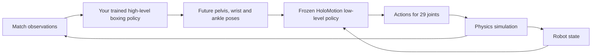
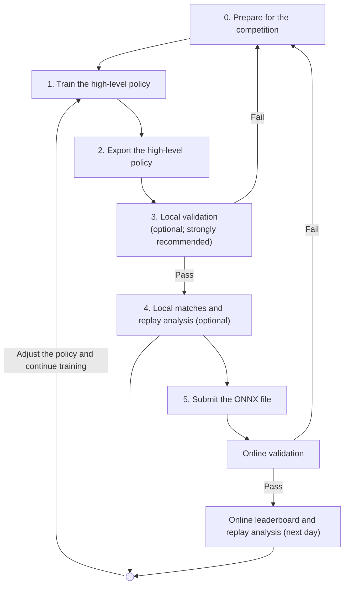

# HoloBoxing tutorial: build a competition boxing policy

English | [简体中文](README.zh-CN.md)

This tutorial helps participants quickly build a high-level boxing policy that meets the competition's submission requirements.
A policy is a model that maps observations to action targets.
You will prepare data, train a policy, export it to ONNX, and evaluate it with the supplied controller on a Unitree G1 robot.
ONNX is a portable neural-network format; your final submission is one ONNX model containing your high-level policy.

## 0. Prepare for the competition

Review the rules and policy interface, then install the required environments.
Each environment version only needs to be set up once.
See [Policy interface](#policy-interface) for the complete input and output definitions.

### Match rules

Read these rules before choosing data, rewards, or a network.
One match has one round of at most **60 simulation seconds**.
The policy runs at **50 Hz**, with one decision every **20 ms**; physics runs at **200 Hz**.
Simulation time and the time spent waiting for a command are different.

| Rule | What counts |
| --- | --- |
| Legal hit | A hand contacts the opponent's head or torso. Kicks do not score. |
| Hit score | Accumulate at least **5 N·s** normal impulse within **20 ms** to earn **1 point**. |
| Repeat hit | Each hand has a **200 ms** scoring cooldown. Scoring consumes its accumulated impulse; separation is unnecessary. |
| Fall | The pelvis or torso body origin is strictly below **0.30 m** above the arena floor. Tilt alone does not count. |
| Knockout (KO) | A robot that remains fallen for **3 seconds** is knocked out. Its opponent receives **1,000 points**, and the round ends. |
| Winner | The opponent of a single knocked-out robot wins. Simultaneous confirmed falls draw. At timeout, higher score wins; equal scores draw. |

Normal impulse is perpendicular contact force accumulated over time, measured in newton-seconds.
Peak force, friction, and closing speed do not replace the impulse threshold.
Falls are ordered by their 50 Hz observation timestamps; array order never breaks a simultaneous-fall tie.
Match results include the applied rule version and numeric settings.

Your submitted model must meet these requirements:

| Requirement | Limit |
| --- | --- |
| Model | One self-contained `.onnx` file, strictly smaller than **50,000,000 bytes** |
| Input | `obs`, float32, shape `[1,1097]` |
| Output | `target_pose`, float32, shape `[1,225]` |
| Targets | Pelvis, left wrist, right wrist, left ankle, right ankle; five future times from 20 to 100 ms |
| Low-level controller | All entries must use the competition-specified HoloMotion V2 controller. Replacing the model or modifying its parameters is prohibited. |
| Initial-round hardware | **RTX 5090** |
| Complete-chain latency | Mean **≤5 ms**, including your policy and the frozen controller; 10 warmup steps and 100 measured steps |

Later-round S600 execution needs separate target validation.
You can run local timing on other supported NVIDIA GPUs; official qualification uses the RTX 5090.

### How the two policy layers work

The competition separates boxing decisions from joint execution.
"High-level" and "low-level" describe these responsibilities:

| Layer | Inputs and outputs | Who supplies it? |
| --- | --- | --- |
| High-level boxing policy | Reads self-state history, opponent positions, remaining time, and score difference. Predicts future poses for the pelvis, both wrists, and both ankles. | You train and submit this policy. |
| Low-level whole-body tracking policy | Reads the high-level targets and robot state. Produces actions for the robot's 29 joints. | The competition supplies the mandatory controller version. Participants must not replace the model or modify its parameters. |

A pose includes position and orientation.
The high-level policy predicts five future poses per body point, covering 20–100 ms.
The runtime converts the low-level actions into joint position targets for the simulator.
Both policies run in sequence at each 20 ms control step.



This design helps you focus on the competition policy:

- **Less training work.** Reuse the pretrained policy's whole-body tracking capabilities while developing your boxing decisions.
- **Less interface adaptation.** This tutorial connects data preparation, target encoding, ONNX export, and evaluation through the competition interface.
- **Consistent evaluation conditions.** The low-level controller is a fixed competition component, mandatory for every entry. Participants train and submit only the high-level boxing policy.

### Get the code

Skip cloning if you already have this checkout. Run later commands from the HoloMotion repository root, one directory above `holoboxing/`.
The clone skips large-file downloads unrelated to this workflow.

```bash
GIT_LFS_SKIP_SMUDGE=1 git clone https://github.com/HorizonRobotics/HoloMotion.git
cd HoloMotion
```

### Install the evaluation environment

Install the following software and download the competition image for Docker-based evaluation.
Local evaluation needs **Docker and NVIDIA Container Toolkit**, which gives containers GPU access; it does not need host Python.
Replay playback needs only Docker and a browser.

```bash
export HOLOBOXING_IMAGE="horizonrobotics/holomotion:holoboxing-eval-v11-amd64"
docker pull --platform linux/amd64 "$HOLOBOXING_IMAGE"
```

The low-level controller model, its parameters, and evaluation resources are bundled; no additional resource downloads are needed.
Use the round's announced image to reuse the official packaged software and resources.
GPU hardware and host drivers still depend on the machine running the image.

For an offline delivery, use the supplied archive instead of pulling:

```bash
sha256sum --check SHA256SUMS
docker load --input holoboxing-eval-v11-amd64.tar.gz
export HOLOBOXING_IMAGE="holoboxing-eval:local-v11"
```

These commands verify the archive before importing the image.

### Install the training environment (optional)

Install this environment if you use the reference training implementation in step 1.
For your own training method, use your own training environment.

Use Linux x86-64, an NVIDIA GPU with a CUDA 12.8-compatible driver, and **Python 3.11**.
This standalone environment supports data preparation, training, and export.
The reference implementation uses MuJoCo; Isaac Sim, Isaac Lab, and the full HoloMotion environment are unnecessary.

```bash
python3.11 -m venv .venv-holoboxing
source .venv-holoboxing/bin/activate
python -m pip install --upgrade pip
python -m pip install torch==2.9.1 --index-url https://download.pytorch.org/whl/cu128
python -m pip install -r holoboxing/training/requirements.txt
python -m pip check
python -c 'import torch; assert torch.cuda.is_available(); print(torch.cuda.get_device_name(0))'
```

The Python packages supply CUDA libraries; no separate compiler toolkit is required.
Keep this environment active through training and export. In a new terminal, reactivate it and restore the path variables.

Reference reinforcement learning runs on the host and its physics implementation pins Warp 1.11.
Evaluation runs inside Docker, independently of the host Python environment.

Install Git LFS for resource downloads.
The commands below retrieve the matching resources and competition-specified low-level controller.
The programs automatically verify the resource inventory and file contents.

```bash
GIT_LFS_SKIP_SMUDGE=1 git submodule update --init thirdparties/HoloMotion_assets
git -C thirdparties/HoloMotion_assets lfs pull --include="holoboxing/**" --exclude=""
export HOLOBOXING_ASSETS="$PWD/holoboxing/assets"
python -m holoboxing download --directory models/holomotion-v2
export HOLOBOXING_LOWER="$PWD/models/holomotion-v2"
```

Keep each resource bundle intact. `HOLOBOXING_ASSETS` must contain `resources.json`.
`HOLOBOXING_LOWER` must contain `config.yaml` and `exported/model_10500.onnx`.
Download these resources once.

## Tutorial workflow

After step 0, follow steps 1–5 to prepare and submit your policy.
Steps 3 and 4 are optional.
We strongly recommend local validation before submission to catch interface and latency problems early.
Use your own training method or follow the reference implementation below.
Every entry must follow the competition interface, use the specified low-level controller, and meet the evaluation rules.



| Module | Purpose | What you change or produce |
| --- | --- | --- |
| Reference motions | Supply targets for supervised initialization and examples for motion-style rewards during reinforcement learning. | Your data selection and prepared dataset |
| Supervised learning (SL) | Jointly trains the high-level policy's task branch, history branch, and decoder on reference targets. | An initial policy checkpoint, `.pt`, for reinforcement learning |
| Reinforcement learning (RL) | Improves the attacker using boxing rewards. A humanoid sandbag supplies the opposing training role. | Your policy, rewards, and training settings |
| Frozen HoloMotion controller | Tracks five-point targets with the whole robot. Training and evaluation use the competition-specified version. | The supplied controller is mandatory; replacing or modifying it is prohibited. |
| Evaluator | Executes both policies, simulates contacts, applies the rules, and records results. | Your exported `.onnx` is its input. |
| Replay | Shows recorded states, scores, and events so you can diagnose the policy. | Inspect behavior and export video. |

The examples below use a small dataset and short training runs to help you complete your first run.
After that, expand the data and training as needed.

## 1. Train the high-level policy

Choose your own data, network, and learning method, or use the reference implementation below.
It initializes a policy through imitation learning, then improves boxing behavior through reinforcement learning.
Every entry must preserve the competition interface and use the specified low-level controller.

### Initialize the policy from reference motions

This example uses supervised learning (SL) to imitate reference motions by predicting future target poses from observations.
The same reference motions also supply motion-style examples during reinforcement learning.

The two data sources differ in whether they require retargeting:

| Source | Original data | Preparation |
| --- | --- | --- |
| **RoboStriker** | G1 robot motions | Preprocess directly into training samples. |
| **InterHuman** | Two-person human motions | Retarget to G1 with HoloRetarget, then use the same preprocessing pipeline. |

Start with two RoboStriker motion groups. Each group contains an original motion and its mirror.
Complete this path first before adding optional human-motion data.

```bash
python -m holoboxing.data download robostriker \
  --output holoboxing/data/raw/RoboStriker --limit-groups 2 --workers 2
python -m holoboxing.data prepare \
  --source holoboxing/data/raw/RoboStriker \
  --output holoboxing/data/processed/RoboStriker \
  --assets "$HOLOBOXING_ASSETS" --workers 2
python -m holoboxing.data verify \
  --output holoboxing/data/processed/RoboStriker --assets "$HOLOBOXING_ASSETS"
export HOLOBOXING_DATA="$PWD/holoboxing/data/processed/RoboStriker/prepared"
```

Preparation produces 1097-value observations and 225-value targets. Later training reads `prepared/`.
Original and mirrored motions stay in the same split. This two-group example assigns one group to training and one to validation.
RoboStriker contains single-robot trajectories; this example adds a synthetic standing opponent when constructing observations.
Resolve any preprocessing failure recorded in `FAILED.json` before training.
Use a new output directory after changing data or resources. Remove `--limit-groups` when expanding the dataset.

<details>

<summary>Optional: use human-motion data</summary>

This path uses [HoloRetarget](../holoretarget/README.md) to convert InterHuman motions to G1 motions.
The `holoboxing.data retarget` command below calls HoloRetarget.
Add the converted trajectories to the reference motion dataset.
The combined data supplies both supervised targets and motion-style examples for reinforcement learning.

HoloRetarget uses Newton for solving. The current Newton 1.0 dependency requires Warp 1.12.
Run retargeting in the separate environment below. Keep the reference training environment and evaluation image unchanged.
This path also requires a licensed neutral SMPL body model. You may skip it for your first run.
Obtain the body model from the [official SMPL website](https://smpl.is.tue.mpg.de/) and replace the model path below.
InterHuman permits noncommercial use and prohibits redistribution. Preserve its license; do not redistribute licensed body models.

```bash
python -m holoboxing.data download interhuman \
  --output holoboxing/data/raw/InterHuman --limit-clips 2 --workers 2
python3.11 -m venv .venv-holoboxing-retarget
.venv-holoboxing-retarget/bin/python -m pip install torch==2.9.1 --index-url https://download.pytorch.org/whl/cu128
.venv-holoboxing-retarget/bin/python -m pip install numpy==2.2.6 scipy==1.15.3 mujoco==3.5.0 warp-lang==1.12.0 newton==1.0.0 trimesh==4.6.8 PyYAML==6.0.2
.venv-holoboxing-retarget/bin/python -m holoboxing.data retarget \
  --source holoboxing/data/raw/InterHuman \
  --output holoboxing/data/converted/InterHuman \
  --smpl-model /path/to/licensed/neutral-smpl.pkl \
  --assets "$HOLOBOXING_ASSETS" --device cuda:0 --iterations 4
python -m holoboxing.data prepare \
  --source holoboxing/data/raw/RoboStriker \
  --source holoboxing/data/converted/InterHuman \
  --output holoboxing/data/processed/combined \
  --assets "$HOLOBOXING_ASSETS" --workers 2
python -m holoboxing.data verify \
  --output holoboxing/data/processed/combined --assets "$HOLOBOXING_ASSETS"
export HOLOBOXING_DATA="$PWD/holoboxing/data/processed/combined/prepared"
```

Only retargeting uses `.venv-holoboxing-retarget`; other commands continue using `python` from the boxing environment.
Downloads and conversion preserve the official data splits.
`HOLOBOXING_DATA` now selects the combined dataset. Continue with the training commands below.

</details>

Train for one epoch, meaning one complete pass through the selected data:

```bash
CUDA_VISIBLE_DEVICES=0 python -m holoboxing.training.train_sl \
  --assets "$HOLOBOXING_ASSETS" --lower "$HOLOBOXING_LOWER" \
  --data "$HOLOBOXING_DATA" --output results/boxing-sl \
  --epochs 1 --device cuda:0
```

The checkpoint `results/boxing-sl/epoch_000001.pt` contains policy parameters and observation statistics for reinforcement learning.
Export the policy to ONNX before submitting it.

Supervised training jointly updates the task branch, history branch, and decoder.
The history branch is named `prior` in the code.
The decoder maps the current state and internal features to target poses.
Reinforcement learning continues updating these high-level network parameters.

### Improve boxing behavior through reinforcement learning

Reinforcement learning (RL) improves the policy using rewards from simulated interactions.
The example trains an attacker against a humanoid sandbag with Proximal Policy Optimization (PPO).
An Adversarial Motion Prior (AMP) uses a discriminator to distinguish policy motions from reference motions.
Its style reward encourages reference movement patterns.
The competition-specified controller remains fixed throughout training.

Start with 16 parallel environments and one PPO update:

```bash
CUDA_VISIBLE_DEVICES=0 python -m holoboxing.training.train_rl \
  --assets "$HOLOBOXING_ASSETS" --lower "$HOLOBOXING_LOWER" \
  --amp-motions "$HOLOBOXING_DATA" \
  --supervised-checkpoint results/boxing-sl/epoch_000001.pt \
  --output results/boxing-rl --num-envs 16 --updates 1 --device cuda:0
```

The checkpoint is `results/boxing-rl/model_1.pt`. The first launch compiles GPU physics kernels.
After the first successful run, increase `--epochs` and `--updates`; choose `--num-envs` according to available GPU memory.
Select the matching checkpoint number when exporting.
These settings complete an initial training run. Assess boxing performance through evaluation and replays.

## 2. Export your policy

This section exports the high-level policy trained by the reference implementation.
If you use your own training method, you may provide your own ONNX exporter, preserving the required file format and input/output interface.

The example exporter includes policy observation normalization and checks CPU agreement with the training model.
It does not export the frozen controller or optimizer.

```bash
python -m holoboxing.training.export \
  --checkpoint results/boxing-rl/model_1.pt --output results/boxing.onnx
```

A supervised checkpoint can also be exported directly with the same command.
The resulting file must satisfy the rule and interface tables above.
Export checks alone do not establish GPU timing or boxing skill.

## 3. Local validation (optional; strongly recommended)

This step is optional but strongly recommended before submission.
It checks model compatibility and measures complete-chain latency.

```bash
./holoboxing/run.sh --validate results/boxing.onnx
./holoboxing/run.sh --validate results/boxing.onnx --benchmark --output results/benchmark.json
```

The first command checks size, ONNX structure, deterministic operators, tensor names/shapes, output validity, and one real CUDA inference.
It writes `results/validation.json`. It leaves complete-chain performance `NOT_RUN` and official qualification `NOT_EVALUATED`; `actual_fps=0` means unmeasured.
The second command measures your policy together with the frozen controller, using 10 warmup steps and 100 measured steps.
It reports the actual GPU model and measured latency, including on GPUs other than the RTX 5090.
For a different GPU, the report warns that your hardware differs from the official RTX 5090.
You may estimate RTX 5090 latency from your own measurements; you are responsible for the conversion and its risk.
Official acceptance depends on measurements taken on the RTX 5090.

The timed chain includes observations, your policy, decoding, controller inference, recurrent-state updates, and target conversion.
Physics and output repair are outside this 5 ms chain measurement. Inference and match physics have no CPU fallback.

If validation fails, read the report and return to step 0 to check the interface, latency requirements, and evaluation environment.
Fix the issue, then validate again.

After validation passes, continue with optional step 4 or submit your model directly.

## 4. Local matches and replay analysis (optional)

This optional step helps you assess behavior before submitting.
Run a local match, then use its replay to inspect hits, falls, and movement.

### Run a match

Prepare several policies and export each as an ONNX model.
Match different policies against each other to compare training checkpoints or approaches.
You can also let one policy control both sides to observe its behavior.

The example below uses the same policy for both the red and blue robots:

```bash
./holoboxing/run.sh --match results/boxing.onnx results/boxing.onnx --output results/first-match
```

Replace the second path with another compatible policy when available.
The first model controls the red robot; the second controls the blue robot.
The evaluator runs both policies through the frozen controller, simulates the round, and applies the rules above.
`results/first-match/match.json` contains scores, winner, events, and diagnostics; `replay.hdf5` contains the recorded states.
A model can pass interface checks and still fall immediately or score 0:0.

### Watch the replay

```bash
./holoboxing/run.sh --view results/first-match/replay.hdf5
```

Open `http://localhost:8080`. Play, pause, seek, and inspect hit/KO markers before deciding what to train next.
Playback uses recorded states; it does not execute policies or rerun physics.
MP4 export needs a compatible Chrome/Edge browser on localhost or trusted HTTPS. Keep the tab visible during export.
For a remote machine, forward port 8080 through SSH to your own localhost. Stop the player with Ctrl+C.

Results are not overwritten. Choose a new `--output` for another run, `--gpu` for another host GPU, or `--port` for another player port.

## 5. Submit

Upload **`results/boxing.onnx`** through the competition's model submission page.
Submit the high-level policy only. Training checkpoints, data, the controller bundle, and replay files are not model submissions.
After upload, the service checks the model interface and complete-chain latency.
Online validation is mandatory even if you skip local validation.
The model enters online matches only after validation passes.
If validation fails, follow the report and return to step 0 to check and fix the issue.

After validation passes, check the leaderboard and online match replays the next day.
Use the ranking and replays to guide further training, then export, validate, and submit again.

Local matches do not update the official leaderboard.

## Policy interface

Your **high-level boxing policy** predicts future poses for five body points. The bundled,
**frozen HoloMotion low-level tracker** converts these targets into joint actions.
Submit only the high-level boxing policy; its file must be self-contained and strictly
smaller than **50,000,000 bytes**. External tensor files are unsupported.

A tensor is a numbered array. The runtime uses batch size 1 and float32 values
without automatic normalization. A symbolic batch dimension may support size 1.

| Direction | Tensor name | Type | Shape |
| --- | --- | --- | --- |
| Input | `obs` | float32 | `[1,1097]` |
| Output | `target_pose` | float32 | `[1,225]` |

Optional ONNX metadata `policy_contract`, when present, must equal
`holomotion_v2_boxing_obs1097_target_pose225_v1`.

Export in inference mode. Random ONNX operators and training-mode Dropout are
unsupported, including inside branches and local functions. Wide TopK selections
require a known last-axis width and constant `K` between 1 and 128.
Unsupported selections fail validation.

### Coordinate frames

The **controlled robot** runs this policy; the **opponent** is the other robot.
All coordinates below use the controlled robot as their reference:

| Frame | Origin | Axis orientation |
| --- | --- | --- |
| Controlled robot's pelvis frame | Its current measured pelvis position | Follows its pelvis's full 3D rotation: roll, pitch, and yaw |
| Controlled robot's heading frame | Its current measured pelvis position | Follows only its pelvis yaw; Z stays vertical in world coordinates |

### Observations

Slices use zero-based, half-open indexing. Flattening varies the last axis fastest.

| Slice in `obs` | Meaning | Shape before flattening |
| --- | --- | --- |
| `[0:1080]` | Ten measured self states, oldest to current, spaced 20 ms apart | `[10,108]` |
| `[1080:1095]` | Opponent point positions expressed in the controlled robot's current pelvis frame | `[5,3]` |
| `[1095:1096]` | Remaining round time, seconds | `[1]` |
| `[1096:1097]` | Controlled robot's score minus opponent's score | `[1]` |

Each 108-value self state contains:

| Slice within one state | Meaning | Shape |
| --- | --- | --- |
| `[0:3]` | Pelvis angular velocity in its sampling-time body frame, radians/second | `[3]` |
| `[3:48]` | Five measured point poses in the controlled robot's current heading frame | `[5,9]` |
| `[48:63]` | Point linear velocities in the controlled robot's current heading frame, metres/second | `[5,3]` |
| `[63:108]` | The preceding sample's point poses in the controlled robot's current heading frame | `[5,9]` |

Historical poses use the controlled robot's **current** heading frame, including its current origin.
Linear velocities use its current heading axes without subtracting pelvis velocity. Angular velocity keeps its original
sampling-time body frame. The current state occupies `obs[:,972:1080]`.
After reset, every history slot repeats the first measured state; its preceding
pose equals its current pose. Observation precedes this step's action.

For each sample, point poses, point linear velocities, and pelvis angular velocity
derive from the same current joint positions (`qpos`) and velocities (`qvel`).
The isolated observation refresh preserves physics solver and contact state.

### Targets

Reshape `target_pose` to `[1,5,5,9]`: batch, future time, body point, pose component.

| Axis | Order |
| --- | --- |
| Future time | 20, 40, 60, 80, 100 ms after the current observation |
| Body point | Pelvis, left wrist, right wrist, left ankle, right ankle |
| Exact body names | `pelvis`, `left_wrist_yaw_link`, `right_wrist_yaw_link`, `left_ankle_roll_link`, `right_ankle_roll_link` |
| Pose components | `px,py,pz,Xx,Xy,Xz,Zx,Zy,Zz` |

Each point pose combines **3D position + 6D rotation**, giving nine values.
Positions use metres. The rotation follows the continuous 6D representation
introduced by Zhou et al.,
[*On the Continuity of Rotation Representations in Neural Networks*, CVPR 2019](https://arxiv.org/abs/1812.07035).

This interface stores the rotation matrix's **first and third columns**:
`X = (Xx,Xy,Xz)` and `Z = (Zx,Zy,Zz)`. Recover the second column as
`Y = Z × X`, giving `R = [X Y Z]`. The model must output orthogonal unit X/Z
axes; the evaluator checks them with tolerance `1e-3`.

Zhou et al.'s paper motivates the continuous 6D representation.
The X/Z column order above is this interface's convention; do not infer the
packing from another implementation's 6D field order.

Every future target is expressed in the controlled robot's current pelvis frame.

Nonfinite output positions become zero. A nonfinite orientation component
replaces that point's X/Z axes with identity axes; diagnostics count these repairs.
Finite invalid orientations remain errors. Measured states, physics, frozen
features, and recurrent caches are never repaired. The low-level tracker receives
all five future point sets; its packing, validity masks, weights, and state remain fixed.

## Troubleshooting

| What you see | What to do |
| --- | --- |
| `python3.11` or `venv` unavailable | Install Python 3.11 with its `venv` support, then recreate the boxing environment. |
| An import fails after installation | Activate `.venv-holoboxing`, run the requirements command again, and check `python -m pip check`. |
| CUDA unavailable in training | Check the NVIDIA driver and the CUDA Torch wheel using the installation probe. |
| CUDA unavailable only in Docker | Check NVIDIA Container Toolkit and Docker GPU access. |
| GPU memory exhausted | Reduce `--num-envs`; use a new output directory for the revised run. |
| `Image unavailable` | Pull/load the selected image and check `HOLOBOXING_IMAGE`. |
| `Output already exists` | Select a new `--output`; do not mix results from different runs. |
| Data/resource identity mismatch | Regenerate the data with the same robot bundle used for training. |
| `MODEL_TOO_LARGE` | Keep the complete ONNX file strictly below 50,000,000 bytes. |
| `FORMAT_CHECK_FAILED` | Export one valid ONNX without external tensor files. |
| `CONTRACT_CHECK_FAILED` | Check tensor names, types, dimensions, and rotations in the policy interface above. |
| Timing report identifies a different GPU | Use the reported latency for your own estimate of RTX 5090 performance; you accept the conversion risk. |
| A valid model falls or never hits | Watch the replay. Check coordinate frames, target scale, reference quality, and rewards. |

## Customize your training

| Change | Implementation |
| --- | --- |
| High-level policy architecture | `training/rsl_rl/modules/actor_critic.py` |
| Observation normalization | `training/rsl_rl/modules/normalization.py` |
| Training environment and observations | `training/envs/mujoco_env.py` |
| Attacker/sandbag rewards | `training/tasks/combat/mdp/rewards.py`, `training/envs/mujoco_rewards.py` |
| PPO, AMP, and default settings | `training/configs/training.json` |

The task/history branches form a normalized 32-dimensional internal latent representation.
A jointly trained decoder turns it into 225 target values; PPO samples those 225-dimensional actions.
This differs from selecting latent actions for a separately pretrained motion decoder.
Keep the submitted input/output contract unchanged when modifying the example.

## Building the image

Use the round's published image to reuse the supplied evaluation code, dependencies, robot/ring resources, and frozen controller.
Participants may also build their own image with Docker BuildKit.
To reproduce the official environment, use matching source, base images, locked dependencies, resources, and controller versions:

```bash
./holoboxing/evaluation/build.sh \
  --assets "$HOLOBOXING_ASSETS" --lower "$HOLOBOXING_LOWER" \
  --context /absolute/path/to/new-build-context --image holoboxing-eval:custom
```

The builder verifies model/resource hashes and records source and dependency identities.
Self-built images must retain the competition-specified low-level controller without replacement or modification.
Compare your build with the official version, then rerun model validation and matches.

## Sources and attribution

The training examples adapt the sandbag/PPO/AMP structure from
[Yin et al., RoboStriker](https://arxiv.org/abs/2608.16195) and its [preview repository](https://github.com/yinkangning0124/RoboStriker-Preview).
The data and training implementations serve as references for participants.
They connect to the competition policy interface and frozen HoloMotion V2 tracker, reducing the work needed to complete the training and evaluation workflow.
The implementation retains [RSL-RL license notices](training/rsl_rl/LICENSE).

Other method references are [PPO](https://arxiv.org/abs/1707.06347),
[Generalized Advantage Estimation](https://arxiv.org/abs/1506.02438),
[AMP](https://xbpeng.github.io/projects/AMP/), and [SMPLOlympics](https://arxiv.org/abs/2407.00187).
The [HoloMotion-1 report](https://arxiv.org/abs/2605.15336) describes V1; the V2 interface follows the pinned controller and current implementation.
The optional paired-motion source is [InterHuman](https://github.com/tr3e/InterGen#interhuman-dataset).
