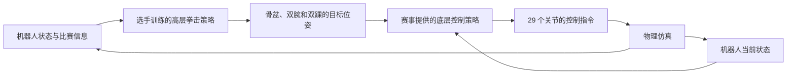
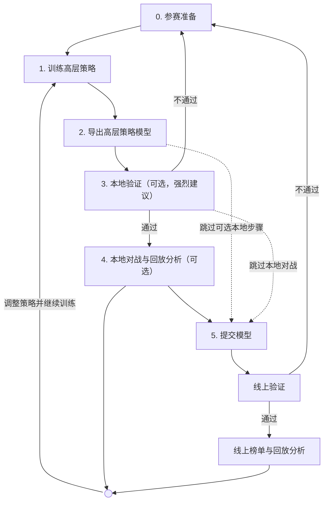

# H-bot Competition 赛道2 参赛入门教程

[English](README.md) | 简体中文

本教程面向 H-bot Competition 赛道2 参赛选手。目标是尽快训练出满足提交要求的高层拳击策略。教程覆盖数据准备、策略训练、模型导出和本地评测。

比赛官网为 [H-bot Competition 竞赛平台](https://hbot-competition.horizon.auto/)。模型提交和榜单入口请见站内导航。当前榜单中的方法和成绩为测试数据。它们不代表正式排名。

比赛使用 Unitree G1 人形机器人。选手需提交单个 ONNX 模型文件。ONNX 是通用的神经网络模型格式。

教程中的数据和训练方法供选手参考。示例代码已适配比赛接口，可减少训练与评测的接口适配工作。选手可在此基础上调整数据、高层网络结构和训练算法。

## 0. 参赛准备

本节介绍比赛规则、模型接口和环境安装。同一版本的环境只需准备一次。输入输出的完整定义见[策略接口](#策略接口)。

### 比赛规则

训练前，请先了解计分方式和模型要求。每场比赛只有一个回合，最多运行 **60 秒仿真时间**。策略每 **20 ms** 执行一次，即 **50 Hz**。物理仿真的更新频率为 **200 Hz**。

这里的 60 秒是仿真时长。命令实际运行多久，取决于计算机性能。

| 规则 | 判定方式 |
| --- | --- |
| 有效命中 | 手部接触对方头部或躯干。脚部攻击不计分。 |
| 命中得分 | 单只手在 **20 ms** 内累计法向冲量达到 **5 N·s**，得 **1 分**。 |
| 连续得分 | 同一只手两次得分至少间隔 **200 ms**。得分后，该手重新累计冲量，无需先与对方分离。 |
| 倒地 | 骨盆或躯干刚体原点的离地高度 **<0.30 m**。仅身体倾斜不算倒地。 |
| 被击倒（KO） | 一方连续倒地 **3 秒**，判该方被 KO。对方获得 **1,000 分**，回合立即结束。 |
| 胜负 | 一方被 KO，另一方获胜。双方同时被 KO，则判平局。回合超时后，得分高者获胜，同分则判平局。 |

法向冲量是接触法向力随时间的积分，单位为牛顿秒（N·s）。计分依据是法向冲量，摩擦力、峰值力和接近速度不单独计分。

倒地先后以 50 Hz 观测记录的时间戳为准。不能根据事件在数组中的顺序判定先后。比赛结果会记录所用规则的版本及参数。

模型提交要求如下：

| 项目 | 要求 |
| --- | --- |
| 模型文件 | 单个 `.onnx` 文件，大小 **<50,000,000 字节**。模型结构和全部权重须保存在同一文件中。 |
| 输入 | 名称为 `obs`，类型为 float32，形状为 `[1,1097]`。 |
| 输出 | 名称为 `target_pose`，类型为 float32，形状为 `[1,225]`。 |
| 输出内容 | 骨盆、双腕和双踝在未来五个时刻的目标位姿。五个时刻分布在未来 20–100 ms。 |
| 底层控制器 | 必须使用赛事指定的 HoloMotion V2 版本。不得替换模型或修改参数。 |
| 初赛评测显卡 | **RTX 5090**。 |
| 完整推理链性能 | 高层策略与底层控制器的平均总时延 **≤10 ms**。对应性能为 **≥100 FPS**。先预热 10 次，再测量 100 次。 |

云端测试使用以下硬件：

- CPU：`Intel Xeon Platinum 8558P`。
- GPU：`NVIDIA GeForce RTX 5090`。

本地结果可能与云端不同。是否通过，以云端系统结果为准。FPS由 `1000 / mean_ms` 计算。它表示完整推理链性能。它不是策略或物理仿真的更新频率。

本地测时可使用其他受支持的 NVIDIA 显卡。初赛时延以官方在 RTX 5090 上的实测为准。后续赛程使用 S600，需另行验收。

### 高层策略与底层策略

策略（policy）是根据观测决定动作的模型。观测包括机器人状态、对方位置和比赛信息。本比赛采用两层控制方案，分别负责拳击决策和全身运动控制。

| 层级 | 负责的工作 | 提供方式 |
| --- | --- | --- |
| 高层拳击策略 | 根据观测，预测骨盆、双腕和双踝的目标位姿。它通过这些目标决定出拳、移动和防守动作。 | 由选手训练，并作为参赛模型提交。 |
| 底层运动控制策略 | 根据高层目标和机器人当前状态，生成 29 个关节的控制指令。 | 由赛事统一提供，选手必须使用指定版本。不得替换模型或修改参数。 |

位姿由位置和朝向组成。高层策略为每个关键部位预测五个时刻的目标位姿。它们对应当前观测后 20、40、60、80、100 ms。底层策略跟踪这些目标，协调全身关节运动。

每个 20 ms 控制周期内，先运行高层，再运行底层。运行时将底层输出转换为关节位置目标，交给仿真器执行。



这种设计主要有三点作用：

- **降低训练门槛。** 复用预训练的全身跟踪策略。选手可集中改进出拳、移动和防守决策。
- **减少接口适配工作。** 示例的数据处理、训练和导出使用同一接口。无需分别适配各阶段的数据格式。
- **统一评测条件。** 底层控制器是比赛固定组件，所有选手统一使用。选手仅训练和提交高层拳击策略。

### 获取代码

已有代码可跳过克隆步骤。后续命令均在 HoloMotion 仓库根目录执行。该目录位于 `holoboxing/` 的上一级。克隆时跳过本流程用不到的大文件。

```bash
GIT_LFS_SKIP_SMUDGE=1 git clone https://github.com/HorizonRobotics/HoloMotion.git
cd HoloMotion
```

### 安装评测环境

评测在 Docker 内执行。先安装以下软件，并下载赛事镜像。无需为评测另装主机 Python 环境。

所需软件：

- **Docker**：运行评测容器。请按[官方安装指南](https://docs.docker.com/engine/install/)安装。
- **NVIDIA Container Toolkit**：提供显卡支持。请按[官方安装指南](https://docs.nvidia.com/datacenter/cloud-native/container-toolkit/latest/install-guide.html)配置。

只播放回放时，使用 Docker 和浏览器即可。

```bash
export HOLOBOXING_IMAGE="horizonrobotics/holomotion:holoboxing-eval-v12-amd64"
docker pull --platform linux/amd64 "$HOLOBOXING_IMAGE"
```

镜像信息见 [Docker Hub 仓库页](https://hub.docker.com/layers/horizonrobotics/holomotion/holoboxing-eval-v12-amd64)。安装后，先检查 Docker 与显卡访问：

```bash
docker version
nvidia-smi
docker run --rm --gpus all --entrypoint nvidia-smi "$HOLOBOXING_IMAGE" -L
```

底层控制器模型、参数及评测资源已内置，无需另行下载。使用当前赛程指定的镜像，可减少本地与云端的环境差异。显卡型号和驱动版本仍以主机配置为准。

离线机器不能拉取镜像时，先在联网机器导出。导出目录必须不存在。脚本会生成镜像归档、摘要及镜像身份记录。它不会发布或修改镜像标签。

```bash
./holoboxing/evaluation/export.sh \
  --image "$HOLOBOXING_IMAGE" --output-dir /absolute/path/to/new-offline-delivery
```

将整个交付目录复制到离线机器。随后校验、导入并核对镜像身份：

```bash
cd /path/to/offline-delivery
sha256sum --check SHA256SUMS
docker load --input holoboxing-eval-v12-amd64.tar.gz
export HOLOBOXING_IMAGE="horizonrobotics/holomotion:holoboxing-eval-v12-amd64"
docker image inspect --format '{{.Id}}' "$HOLOBOXING_IMAGE"
cat IMAGE_ID
```

最后两条命令的镜像身份应一致。自定义镜像需使用交付记录中的镜像引用。该引用保存在 `IMAGE_REFERENCE`。Docker Hub 提供拉取入口。它不是独立离线归档的下载页。无法自行导出时，请向赛事方索取完整交付目录。

### 安装训练环境（可选）

使用第 1 步的参考训练方案时，需安装以下环境。自选训练方案可使用自己的训练环境。

准备配有 NVIDIA 显卡的 Linux x86-64 主机。安装 **Python 3.11**，显卡驱动须支持 CUDA 12.8。以下独立环境用于数据处理、训练和导出。无需安装完整的 HoloMotion 环境。参考训练使用 MuJoCo。无需安装 Isaac Sim 或 Isaac Lab。

```bash
python3.11 -m venv .venv-holoboxing
source .venv-holoboxing/bin/activate
python -m pip install --upgrade pip
python -m pip install torch==2.9.1 --index-url https://download.pytorch.org/whl/cu128
python -m pip install -r holoboxing/training/requirements.txt
python -m pip check
python -c 'import torch; assert torch.cuda.is_available(); print(torch.cuda.get_device_name(0))'
```

CUDA 运行库随软件包提供，无需另装编译工具包。训练和导出期间，请保持环境处于激活状态。打开新终端后，需重新激活并设置路径变量。

参考强化学习在主机运行，物理实现固定使用 Warp 1.11。评测在 Docker 内运行，不受主机 Python 环境影响。

资源下载需要 [Git LFS](https://git-lfs.com/)。请先安装，并用 `git lfs version` 检查。下方命令会获取配套资源和赛事指定的底层控制器。程序会自动校验资源清单及文件内容。

```bash
GIT_LFS_SKIP_SMUDGE=1 git submodule update --init thirdparties/HoloMotion_assets
git -C thirdparties/HoloMotion_assets lfs install --local
git -C thirdparties/HoloMotion_assets lfs pull --include="holoboxing/**" --exclude=""
git -C thirdparties/HoloMotion_assets lfs checkout holoboxing
export HOLOBOXING_ASSETS="$PWD/holoboxing/assets"
python -m holoboxing assets --assets "$HOLOBOXING_ASSETS"
python -m holoboxing download --directory models/holomotion-v2
export HOLOBOXING_LOWER="$PWD/models/holomotion-v2"
```

请保留资源包的完整目录结构。`HOLOBOXING_ASSETS` 中应有 `resources.json`。`HOLOBOXING_LOWER` 中应有 `config.yaml` 和 `exported/model_10500.onnx`。这些资源只需下载一次。

### 下载量与空间准备

下表为 v12 固定资源的参考体积。GB 和 MB 均按十进制计算。压缩下载量不等于安装后的磁盘占用。

| 内容 | 参考体积与条件 |
| --- | --- |
| 评测镜像压缩层 | 约 3.94 GB，已包含底层模型。 |
| 训练所需底层模型 | 约 1.65 GB，训练时需单独保存。 |
| 强化学习运行快照 | 另保存底层模型副本，约 1.65 GB。 |
| 机器人资源 | 约 32.2 MB。 |
| RoboStriker 原始样本 | 随动作组变化，以下载清单为准。 |
| Python 环境与生成数据 | 另行占用空间，随依赖和数据量变化。 |
| 本地镜像构建缓存 | 可占数十 GB，还需另存归档及导入后的镜像。 |

请分别预留训练环境、数据和镜像空间。Docker 数据目录可能位于另一块磁盘。下载和构建前，检查两处存储容量：

```bash
df -h .
docker system df
```

通用峰值磁盘及显存下限尚未量化。示例先使用 16 个训练环境。扩大规模前，请检查本机实际占用。

打开新终端后，可集中恢复默认路径：

```bash
source .venv-holoboxing/bin/activate
export HOLOBOXING_IMAGE="horizonrobotics/holomotion:holoboxing-eval-v12-amd64"
export HOLOBOXING_ASSETS="$PWD/holoboxing/assets"
export HOLOBOXING_LOWER="$PWD/models/holomotion-v2"
export HOLOBOXING_DATA="$PWD/holoboxing/data/processed/combined/prepared"
```

## 教程流程

建议先使用少量数据完成一次训练和评测。确认各步骤运行正常后，再扩大数据量和训练规模。

完成第 0 步后，按第 1–5 步准备并提交模型。训练可采用自选方案，也可参考下文实现。第 3、4 步均为可选项。强烈建议提交前完成本地验证。这样可提前发现接口和时延问题。比赛接口、指定底层控制器及评测规则必须遵守。



| 模块 | 用途 | 主要输出或配置 |
| --- | --- | --- |
| 参考动作 | 用于监督初始化，以及强化学习中的动作风格奖励。 | 数据选择与预处理结果。 |
| 动作表示 | 将未来参考位姿编码为32维单位向量，并重建目标位姿。 | 仅使用参考动作的先验，随后冻结其解码器。 |
| 监督学习（SL） | 根据自身当前状态和对手信息，训练使用冻结解码器的规划器。 | 保存规划器、解码器及观测统计量的 `.pt` 检查点。 |
| 强化学习（RL） | 先与站立对手训练，再与冻结的历史策略自博弈。 | 策略模型、奖励函数和自博弈配置。 |
| 底层控制器 | 将目标位姿转换为全身关节动作。训练与评测统一使用赛事指定版本。 | 必须使用配套模型，不得替换或修改。 |
| 评测器 | 运行双方策略、计算物理接触，并按规则计分。 | 输入 ONNX 模型，输出比赛结果与回放。 |
| 回放工具 | 展示动作、比分和比赛事件，便于分析策略。 | 可交互查看，也可导出视频。 |

## 1. 训练高层策略

选手可自行选择数据、网络和训练算法。参考方案分为三个阶段。先学习动作表示，再训练模仿规划器。最后通过强化学习优化拳击行为。规划器训练期间，动作解码器保持冻结。比赛接口和指定底层控制器必须保持一致。

### 准备参考动作

动作表示仅学习未来参考位姿。它不使用策略观测或对手信息。随后通过监督学习（SL）训练规划器。规划器根据当前观测预测目标位姿。训练集中的参考动作还用于动作风格奖励。

参考方案使用两种数据，训练用途不同：

| 数据来源 | 用途 | 接入方式 |
| --- | --- | --- |
| **InterHuman** | 双方动作参与先验训练。配对动作还提供监督目标和风格参考。 | 先将人体动作重定向为 G1 动作。 |
| **RoboStriker** | 单人机器人动作参与先验训练，也补充风格参考。 | 直接读取 G1 轨迹。 |

**本参考方案的监督训练必须使用 InterHuman。** 仅有 RoboStriker 时，不能运行下方监督训练。这些数据及其官方划分都不是参赛要求。选手可使用其他数据，也可自行划分。比赛接口和指定底层控制器仍须遵守。

先下载少量机器人参考动作：

```bash
python -m holoboxing.data download robostriker \
  --output holoboxing/data/raw/RoboStriker --limit-groups 4 --workers 2
```

随后下载并转换双人动作。本节使用 [HoloRetarget](../holoretarget/README.md)。它将 InterHuman 动作转换为 G1 轨迹。该步骤需要已获授权的中性 SMPL 人体模型。请从 [SMPL 官方网站](https://smpl.is.tue.mpg.de/)取得模型，并替换模型路径。

HoloRetarget 使用 Newton 1.0。该版本需要 Warp 1.12。因此重定向使用单独的环境。训练环境继续使用 Warp 1.11。依赖文件也包含旧版 SMPL 所需的 Chumpy。它用于读取人体模型中的形状参数。

InterHuman 仅允许非商业使用，禁止再次分发。请保留原始许可。不要分发已获授权的人体模型。

```bash
python -m holoboxing.data download interhuman \
  --output holoboxing/data/raw/InterHuman \
  --clip-id 1124 --clip-id 1843 --clip-id 4033 --workers 2
python3.11 -m venv .venv-holoboxing-retarget
.venv-holoboxing-retarget/bin/python -m pip install torch==2.9.1 --index-url https://download.pytorch.org/whl/cu128
.venv-holoboxing-retarget/bin/python -m pip install -r holoboxing/data/retarget-requirements.txt
.venv-holoboxing-retarget/bin/python -m pip check
.venv-holoboxing-retarget/bin/python -m holoboxing.data retarget \
  --source holoboxing/data/raw/InterHuman \
  --output holoboxing/data/converted/InterHuman \
  --smpl-model /path/to/licensed/neutral-smpl.pkl \
  --assets "$HOLOBOXING_ASSETS" --device cuda:0 --iterations 4
```

仅重定向使用独立环境。其余命令继续使用拳击环境中的 `python`。示例从三个官方划分中选取人体动作。这样便于调参时分别查看验证和测试指标。这只是实验示例，不是参赛要求。

合并两类轨迹，生成实际状态下的训练观测。此步骤需要 CUDA 显卡及指定底层控制器。程序运行固定底层控制器，采集当前物理状态。未来目标也使用该时刻的实际骨盆坐标系。它不再直接把参考轨迹当作实际观测。

```bash
python -m holoboxing.data prepare \
  --source holoboxing/data/raw/RoboStriker \
  --source holoboxing/data/converted/InterHuman \
  --output holoboxing/data/processed/combined \
  --assets "$HOLOBOXING_ASSETS" --test-fraction 0.1 --workers 2
python -m holoboxing.data verify \
  --output holoboxing/data/processed/combined --assets "$HOLOBOXING_ASSETS"
export HOLOBOXING_DATA="$PWD/holoboxing/data/processed/combined/prepared"
```

预处理生成 1097 维观测及 225 维目标。旧版预处理结果不能直接复用。请使用新目录重新生成。`COMPLETE.json` 固定数据及来源清单。若出现 `FAILED.json`，请先处理所记录的错误。

本参考实现会保留 InterHuman 划分标签。原动作及其镜像始终属于同一划分。监督训练只读取 InterHuman 训练集。归一化与损失统计也只在该集合拟合。动作风格奖励只读取两类数据的训练集。

验证集不参与上述训练或统计拟合。每轮监督训练单独报告验证指标。复用本流程时，旧检查点须有训练划分记录。若缺少记录，请重新训练。两次数据准备须使用相同来源和划分参数。三路划分至少需要三个机器人原动作组。本例下载四组。如需单独验证指标，请预留人体动作验证集。

### 第一阶段：学习动作表示

先生成仅含参考位姿的训练窗口。它与实际状态下的策略观测分别保存：

```bash
python -m holoboxing.training.prepare_prior \
  --source holoboxing/data/raw/RoboStriker \
  --source holoboxing/data/converted/InterHuman \
  --assets "$HOLOBOXING_ASSETS" --output results/boxing-reference
python -m holoboxing.training.train_prior \
  --data results/boxing-reference --output results/boxing-prior \
  --hidden-dims 512 256 --batch-size 1024 --epochs 1000 \
  --seed 43 --device cuda:0
```

编码器将225维参考位姿映射到32维单位向量。解码器将该向量重建为未来五帧的目标位姿。解码网络宽度为32→256→512→225。训练和统计拟合仅使用训练集。

程序根据验证集重建误差提前停止。`results/boxing-prior/best.pt` 保存最佳完整验证轮次的权重。随后冻结解码器参数。梯度仍可通过它更新规划器。参考重建通过，不能证明物理跟踪或拳击表现。

### 第二阶段：通过模仿初始化规划器

规划器使用63维自身当前状态和15维对手信息。它不使用缓存的前一帧位姿或更早历史。对外接口仍为 `obs[1,1097]`。输入选择和归一化均包含在导出模型中。监督学习和强化学习使用同一规划器配置：

```bash
CUDA_VISIBLE_DEVICES=0 python -m holoboxing.training.train_sl \
  --assets "$HOLOBOXING_ASSETS" --lower "$HOLOBOXING_LOWER" \
  --data "$HOLOBOXING_DATA" --prior-checkpoint results/boxing-prior/best.pt \
  --config holoboxing/training/configs/sample.json \
  --output results/boxing-sl --epochs 19 --batch-size 512 \
  --seed 43 --device cuda:0
```

模型保存为 `results/boxing-sl/epoch_000019.pt`。其中包含规划器、冻结解码器和观测统计量。本例预算为完整遍历训练集19次。更换数据或参数时，应根据独立验证选择检查点。训练完成不代表已经能在比赛中获胜。

### 第三阶段：预热及自博弈强化学习

强化学习（RL）根据仿真奖励更新规划器。本例使用近端策略优化算法（PPO）。对抗式动作先验（AMP）提供动作风格奖励。它将策略动作与训练集参考动作比较。AMP与冻结动作解码器是不同组件。解码器和赛事指定底层控制器始终保持冻结。

先与保持世界坐标目标的站立对手训练32次：

```bash
CUDA_VISIBLE_DEVICES=0 python -m holoboxing.training.train_rl \
  --assets "$HOLOBOXING_ASSETS" --lower "$HOLOBOXING_LOWER" \
  --amp-motions "$HOLOBOXING_DATA" \
  --supervised-checkpoint results/boxing-sl/epoch_000019.pt \
  --config holoboxing/training/configs/sample.json \
  --training-mode standing --output results/boxing-warmup \
  --num-envs 128 --updates 32 --seed 42 --device cuda:0
```

再用预热后的规划器和观测统计量启动自博弈：

```bash
CUDA_VISIBLE_DEVICES=0 python -m holoboxing.training.train_rl \
  --assets "$HOLOBOXING_ASSETS" --lower "$HOLOBOXING_LOWER" \
  --amp-motions "$HOLOBOXING_DATA" \
  --policy-checkpoint results/boxing-warmup/model_32.pt \
  --config holoboxing/training/configs/selfplay.json \
  --training-mode selfplay --opponent-pool-capacity 8 \
  --opponent-refresh-updates 256 --output results/boxing-rl \
  --num-envs 128 --updates 256 --seed 42 --device cuda:0
```

自博弈对手为冻结的历史策略。其观测统计量也保持冻结。只有学习方参与策略和判别器更新。替换对手时，在更新边界重置环境和历史。自博弈配置将初始探索标准差从0.1改为0.2。规划器结构保持一致。预期输出为 `results/boxing-rl/model_256.pt`。

首次运行需编译物理计算内核。请在 `training-result.json` 中核对完成次数。达到时限时，可能只保存了较早的检查点。

训练默认完成指定轮次或更新次数，并定期保存。需要时间限制时，应显式设置。可用参数为 `--max-runtime-seconds` 和 `--max-training-seconds`。零表示取消对应限制。`--resume` 用于恢复同一阶段。`--policy-checkpoint` 启动新阶段，并重置学习状态。续训和固定对手评测见[训练参考](training/README.md)。

以上命令提供一套参考训练方案。它不保证任意数据都能训练出获胜策略。精确复现需使用相同权重、统计量和数据版本。运行时及对手版本也须一致。上述小样本用于走通流程。实际战力须从比赛原始站位进行完整对战验收。

## 2. 导出策略模型

本节演示导出前述参考方案训练的高层策略。使用其他训练方案时，也可自行完成 ONNX 导出。模型须符合比赛要求的文件格式和输入输出接口。

示例导出模型包含策略使用的观测归一化处理。底层控制器和优化器不包含在提交文件中。

```bash
python -m holoboxing.training.export \
  --checkpoint results/boxing-rl/model_256.pt --output results/boxing.onnx
```

导出程序会在 CPU 上比较训练模型与 ONNX 模型的输出。监督学习检查点也可直接用此命令导出。导出完成后，继续进行模型检查和本地评测。

## 3. 本地验证（可选，强烈建议）

本步为可选项，但强烈建议提交前执行。它检查模型格式与接口，并测量完整推理链时延。

```bash
./holoboxing/run.sh --validate results/boxing.onnx
./holoboxing/run.sh --validate results/boxing.onnx --benchmark --output results/benchmark.json
```

第一条命令检查模型大小、格式、算子和输入输出接口。通过检查后，会在显卡上执行一次推理。检查结果写入 `results/validation.json`。

快速检查不测量完整推理链的性能。结果中的 `NOT_RUN` 表示尚未测时。`NOT_EVALUATED` 表示尚未进行官方硬件验收。`actual_fps=0` 表示未测量，不代表性能为零。

第二条命令测量高层策略与底层控制器的总时延。先预热 10 次，再测量 100 次。计时还包括观测生成、解码、模型缓存更新和目标转换。物理仿真及输出异常值修正不计入 **10 ms** 指标。

使用其他显卡，也会输出实测时延。报告会注明显卡型号，并提示与官方硬件的差异。其他显卡的结果不能证明 RTX 5090 资格。是否通过，以云端系统结果为准。要求平均时延 **≤10 ms**，对应 **≥100 FPS**。

模型推理和比赛仿真均需使用显卡。

验证不通过时，请先阅读报告。回到第 0 步核对接口、时延要求和评测环境。修正问题后，再次验证模型。

验证通过后，可继续第 4 步或直接提交模型。

## 4. 本地对战与回放分析（可选）

本步用于观察策略表现，不是提交模型的前置要求。先运行对战，再结合回放分析命中、倒地和动作。

### 运行本地对战

可以准备几组策略，分别导出为 ONNX 模型。让不同策略两两对战，比较训练阶段或方案的效果。也可让同一策略控制双方，先观察动作表现。

下面先演示同一策略分别控制红、蓝双方：

```bash
./holoboxing/run.sh --match results/boxing.onnx results/boxing.onnx --output results/first-match
```

第一个模型控制红方，第二个模型控制蓝方。需要比较不同策略时，替换第二个模型路径即可。评测器会执行双方策略、模拟物理接触，并按比赛规则计分。

`results/first-match/match.json` 包含比分、胜负、事件和诊断信息。`replay.hdf5` 保存比赛回放数据。可结合回放检查倒地原因、出拳动作和命中情况。

### 观看比赛回放

```bash
./holoboxing/run.sh --view results/first-match/replay.hdf5
```

在浏览器打开 `http://localhost:8080`。播放器支持播放、暂停和拖动进度，也会显示命中与 KO 标记。回放读取已保存的数据，不会重新运行策略或物理仿真。

导出 MP4 时，请使用兼容的 Chrome 或 Edge 浏览器。页面需位于 localhost 或受信任的 HTTPS 站点。导出期间应保持当前标签页可见。

在远程机器运行时，可通过 SSH 转发 8080 端口。按 Ctrl+C 可停止播放器服务。

再次运行时，请用 `--output` 指定新的输出路径，避免覆盖已有结果。`--gpu` 用于选择主机显卡，`--port` 用于指定播放器端口。

## 5. 提交模型

在[比赛官网](https://hbot-competition.horizon.auto/)的模型提交入口上传 **`results/boxing.onnx`**。只需提交高层策略的 ONNX 文件。无需上传训练检查点、数据、底层控制器或回放文件。

上传后，服务端会检查模型接口与完整推理链时延。即使跳过本地验证，模型也须通过线上验证。通过验证后，模型才会进入线上对战流程。未通过时，请按报告返回第 0 步检查并修正。

线上验证通过后，可在官网查看公布的结果。当前榜单中的方法和成绩为测试数据。它们不代表正式排名。正式赛程和结果以赛事公告为准。

本地对战结果不会更新官方排行榜。

## 策略接口

高层策略预测骨盆、双腕和双踝的目标位姿。评测镜像内置 HoloMotion 底层控制器。该控制器将目标转换为关节动作。

提交文件大小必须 **<50,000,000 字节**。模型结构和全部权重须保存在同一个 ONNX 文件中。不支持将权重存放在外部张量文件中。

张量可以理解为多维数组。评测器按批大小 1、float32 类型读取输入，不自动归一化。批次维度可使用符号名称，但必须支持批大小 1。

| 方向 | 张量名称 | 类型 | 形状 |
| --- | --- | --- | --- |
| 输入 | `obs` | float32 | `[1,1097]` |
| 输出 | `target_pose` | float32 | `[1,225]` |

ONNX 元数据 `policy_contract` 为可选项。如填写，必须使用 `holomotion_v2_boxing_obs1097_target_pose225_v1`。

模型应以推理模式导出。不支持随机算子和训练模式下的 Dropout。模型分支和局部函数中的算子也遵循此要求。

TopK 的选择维度必须具有已知长度。对较长维度执行 TopK 时，只能沿最后一维选择。此时 `K` 必须为 1–128 之间的常量。不满足要求的模型将无法通过检查。

### 坐标系

当前策略控制的机器人称为“本方”。另一台机器人称为“对方”。坐标系均以本方机器人为参照。

| 坐标系 | 原点 | 坐标轴方向 |
| --- | --- | --- |
| 本方骨盆坐标系 | 本方骨盆当前的位置 | 随骨盆完整旋转，包括横滚、俯仰和偏航。 |
| 本方航向坐标系 | 本方骨盆当前的位置 | 只随骨盆偏航旋转。Z 轴保持世界坐标系的竖直方向。 |

### 观测输入

索引从 0 开始，区间包含起点、不包含终点。多维数据展平时，最后一维的索引变化最快。

| `obs` 中的切片 | 含义 | 展平前形状 |
| --- | --- | --- |
| `[0:1080]` | 本方最近 10 帧状态，按时间从早到晚排列。相邻帧间隔 20 ms。 | `[10,108]` |
| `[1080:1095]` | 对方 5 个关键部位的位置。坐标位于本方当前骨盆坐标系。 | `[5,3]` |
| `[1095:1096]` | 本回合剩余时间，单位为秒。 | `[1]` |
| `[1096:1097]` | 本方得分减去对方得分。 | `[1]` |

每帧本方状态包含 108 个值：

| 帧内切片 | 含义 | 形状 |
| --- | --- | --- |
| `[0:3]` | 骨盆角速度，使用采样时刻的机体坐标系。单位为弧度/秒。 | `[3]` |
| `[3:48]` | 5 个关键部位的位姿，转换至本方当前航向坐标系。 | `[5,9]` |
| `[48:63]` | 各关键部位的线速度，使用本方当前航向坐标轴。单位为米/秒。 | `[5,3]` |
| `[63:108]` | 前一采样时刻的关键部位位姿。坐标位于本方当前航向坐标系。 | `[5,9]` |

历史位姿统一转换到本方**当前**航向坐标系。转换时使用当前原点及当前朝向。线速度仅变换坐标轴，不减去骨盆速度。角速度则保留在采样时刻的机体坐标系中。

当前帧位于 `obs[:,972:1080]`。重置后，历史序列各帧均填入第一帧状态。前一时刻位姿也设为该帧的当前位姿。每个控制步先生成观测，再执行动作。

位姿、线速度和骨盆角速度均由同一组当前状态计算。`qpos` 保存根部位姿和关节位置，`qvel` 保存对应速度。更新观测不会改变物理求解器和接触状态。

### 目标位姿

将 `target_pose` 重排为 `[1,5,5,9]`。四个维度依次为批次、未来时刻、关键部位和位姿分量。

| 维度 | 顺序 |
| --- | --- |
| 未来时刻 | 当前观测之后的 20、40、60、80、100 ms。 |
| 关键部位 | 骨盆、左腕、右腕、左踝、右踝。 |
| 刚体名称 | `pelvis`、`left_wrist_yaw_link`、`right_wrist_yaw_link`、`left_ankle_roll_link`、`right_ankle_roll_link`。 |
| 位姿分量 | `px,py,pz,Xx,Xy,Xz,Zx,Zy,Zz`。 |

每个关键部位的位姿用 9 个值表示。其中 **3 维表示位置，6 维表示旋转**。位置单位为米。

旋转使用连续 6 维表示。方法参考 Zhou 等人的 [CVPR 2019 论文](https://arxiv.org/abs/1812.07035)。本接口取旋转矩阵的**第一列和第三列**：`X = (Xx,Xy,Xz)`、`Z = (Zx,Zy,Zz)`。第二列通过 `Y = Z × X` 恢复，得到 `R = [X Y Z]`。

模型输出的 X/Z 轴须互相正交，且均为单位向量。评测器的检查容差为 `1e-3`。X/Z 列顺序是本接口的具体约定，请勿套用其他实现的分量顺序。

所有未来目标均使用本方当前骨盆坐标系。

输出位置中的非有限值会替换为零。朝向分量出现非有限值时，会使用单位旋转的 X/Z 轴。诊断信息会记录修正次数。有限值组成的无效朝向仍会导致报错。

机器人实际状态、物理状态和底层模型特征不做修正。模型状态缓存也不做修正。底层控制器接收全部五组未来目标。目标排列、有效性掩码、权重和状态管理均使用固定配置。

## 常见问题

| 问题 | 处理方法 |
| --- | --- |
| 找不到 `python3.11` 或 `venv` | 安装 Python 3.11 及其虚拟环境组件，再创建训练环境。 |
| 安装后仍提示模块无法导入 | 激活 `.venv-holoboxing` 后重新安装依赖，并运行 `python -m pip check`。 |
| 训练程序无法使用 CUDA | 检查 NVIDIA 驱动和 CUDA 版 PyTorch。再运行安装步骤中的显卡检查命令。 |
| Docker 容器无法使用显卡 | 检查 NVIDIA Container Toolkit。确认容器有权访问显卡。 |
| 显存不足 | 减小 `--num-envs`，并使用新的输出目录重新运行。 |
| `Image unavailable` | 拉取或导入镜像，并检查 `HOLOBOXING_IMAGE`。 |
| `Output already exists` | 使用新的 `--output`，避免混用多次运行的结果。 |
| 数据与机器人资源不匹配 | 使用训练所用的机器人资源重新处理数据。 |
| `MODEL_TOO_LARGE` | ONNX 文件大小须严格小于 50,000,000 字节。 |
| `FORMAT_CHECK_FAILED` | 检查 ONNX 文件是否有效，并确认全部权重均保存在该文件中。 |
| `CONTRACT_CHECK_FAILED` | 核对输入输出名称、类型、维度及旋转表示。 |
| 测时报告提示显卡不同 | 本地结果仅说明实测显卡。正式资格以指定硬件的实测为准。 |
| 模型下载中断或返回 HTTP 403 | 检查代理及重定向下载域名。403 表示访问被拒绝，不能证明模型缺失。保留 `.partial` 文件，重跑同一命令续传。 |
| 下载大小或摘要错误 | 错误信息分别给出实际值和期望值。摘要错误的完整文件保存在 `.invalid`，不作为有效模型使用。 |
| 监督训练提示没有 InterHuman 训练片段 | 完成必需的人体动作重定向及合并预处理。仅有 RoboStriker 不能运行本参考监督训练。 |
| SMPL 形状参数无法读取 | 在重定向环境安装 `holoboxing/data/retarget-requirements.txt`，再运行 `pip check`。 |
| 模型通过检查，但对战表现异常 | 查看回放，检查坐标系、目标尺度、参考动作和奖励函数。 |

## 调整训练方案

| 修改内容 | 对应代码 |
| --- | --- |
| 规划器和动作表示 | `training/spherical_actor.py`、`training/motion_prior.py` |
| 观测归一化 | `training/rsl_rl/modules/normalization.py` |
| 训练环境与观测 | `training/envs/mujoco_env.py` |
| 进攻方及沙袋奖励函数 | `training/tasks/combat/mdp/rewards.py`、`training/envs/mujoco_rewards.py` |
| 站立预热及自博弈配置 | `training/configs/sample.json`、`training/configs/selfplay.json` |
| PPO、AMP 与默认训练参数 | `training/configs/training.json` |

动作编码器和解码器先使用参考位姿训练。规划器预测32维潜在动作。PPO在32维采样空间中保存动作和概率。执行时将采样向量归一化，再交给冻结解码器。解码器输出225维目标位姿。调整网络或算法时，需保留比赛输入输出接口。

## 自行构建评测镜像

建议使用当前赛程公布的镜像，以便复用配套的软件和资源。选手也可自行构建镜像。构建需要 Docker BuildKit。

自行构建时，应使用对应版本的源码和基础镜像。依赖和机器人资源版本也应保持一致。底层控制器必须使用赛事指定版本，不得替换或修改。

```bash
./holoboxing/evaluation/build.sh \
  --assets "$HOLOBOXING_ASSETS" --lower "$HOLOBOXING_LOWER" \
  --context /absolute/path/to/new-build-context --image holoboxing-eval:custom
```

教程生成的 `models/`、`results/` 及数据目录已忽略。它们不会单独导致脏工作区错误。若修改过源码，请加 `--development`。该选项明确记录当前工作区快照。正式发布构建仍要求已提交的干净源码。

使用已发布的 v12 镜像时，应固定镜像摘要。提交标签本身不能证明公开源码对应关系，请核对发布溯源记录。自建镜像须保留 `build-inputs.json` 和 `build-receipt.json`。发布方仍需补齐公开提交与发布包的对应关系。正式发布构建请加 `--verify-public-source`。脚本会先检查公开提交是否可查询。无法验证时，构建会停止。

构建脚本会校验模型与资源文件，并记录源码及依赖版本。构建完成后，请核对记录，重新运行模型检查和本地对战。

## 参考资料与致谢

参考方案包含动作表示、模仿和强化学习。强化学习分为站立预热和自博弈。相关代码参考了 RoboStriker 的 PPO 与 AMP 实现。详见 [Yin 等人的论文](https://arxiv.org/abs/2608.16195)和[项目仓库](https://github.com/yinkangning0124/RoboStriker-Preview)。

本教程提供可参考的数据与训练流程。配套代码已适配比赛接口、底层控制器和评测程序。这样可以减少选手的接口适配工作。实现保留了 [RSL-RL 许可说明](training/rsl_rl/LICENSE)。

其他方法资料见 [PPO](https://arxiv.org/abs/1707.06347)、[广义优势估计](https://arxiv.org/abs/1506.02438)和 [AMP](https://xbpeng.github.io/projects/AMP/)。训练实现也参考了 [SMPLOlympics](https://arxiv.org/abs/2407.00187)。人体动作数据来源为 [InterHuman](https://github.com/tr3e/InterGen#interhuman-dataset)。

[HoloMotion-1 技术报告](https://arxiv.org/abs/2605.15336)介绍 V1。V2 的模型接口以配套控制器和当前代码为准。
